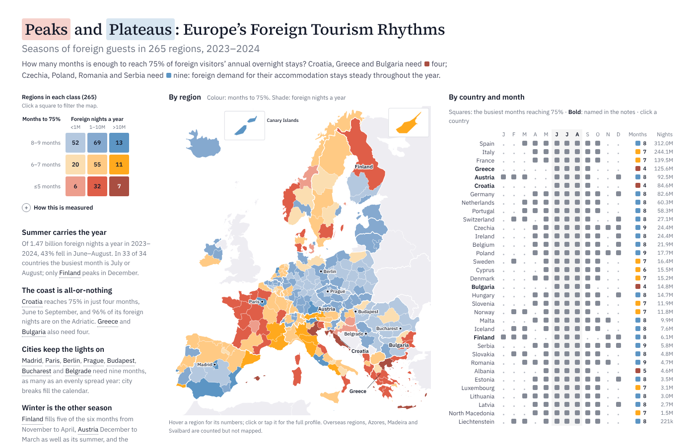

# Peaks and Plateaus: Europe's Foreign Tourism Rhythms

[Explore the Page](https://lomska.github.io/AI-Assisted-Dataviz/EUForeignTourismRhythms)

When do foreign guests come to Europe's regions?
How concentrated are their seasons?
Do they make a region's year more or less seasonal than domestic guests do?

An interactive page exploring these questions for 34 countries (EU-27, EFTA, North Macedonia, Albania and Serbia) and their NUTS 2 regions, average of 2023 and 2024. All figures describe nights in tourist accommodation: hotels, holiday and short-stay accommodation, and campsites.

The folder contains three notebooks:

| Path | Content |
|---|---|
| `Stage 1 Transform.ipynb` | Raw Eurostat files → clean nights with quality flags, nights per day, population, area and geography, tested against the source |
| `Stage 2 Indices.ipynb` | Technical reference: every index (Gini, S_R, months to 75%, season patterns, foreign effect) with its thresholds and robustness checks |
| `Stage 3 Analysis.ipynb` | Findings and conclusions; computes the indices it needs from the Stage 1 file (`.html` export alongside) |

## Sources

- Eurostat, [tour_occ_nin2m](https://ec.europa.eu/eurostat/databrowser/view/tour_occ_nin2m/default/table): nights spent at tourist accommodation establishments by residence of the guest, NUTS 2 regions, monthly, 2023–2024, extract of 7 November 2026
- Eurostat, [demo_r_pjanaggr3](https://ec.europa.eu/eurostat/databrowser/view/demo_r_pjanaggr3/default/table) (population on 1 January) and [reg_area3](https://ec.europa.eu/eurostat/databrowser/view/reg_area3/default/table) (area), by NUTS region
- Eurostat NUTS 2024 classification and LAU 2024 municipalities (geography types)
- Map outlines: Eurostat GISCO, NUTS 2024, 1:20M, via [Nuts2json](https://github.com/eurostat/Nuts2json)
